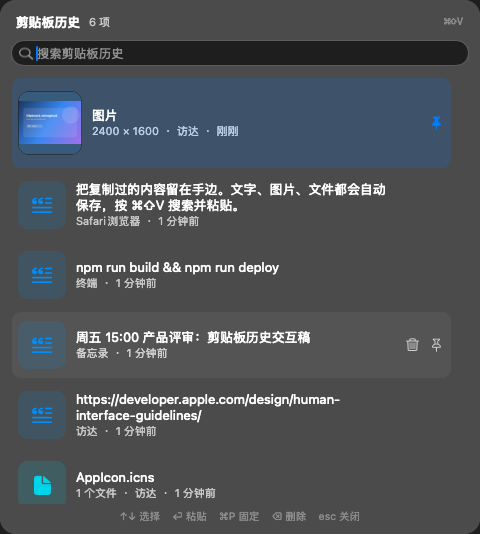

# icopy

像 Windows 剪贴板历史一样的 macOS 菜单栏工具：按 **⌘⇧V** 随时打开复制历史，搜索、固定，然后选中文字、图片或文件直接粘贴。



## 功能

- **自动保存**：文字、图片、文件复制后会自动进入历史，重复内容自动置顶去重。
- **图片支持**：保存截图和复制的图片，列表里直接显示缩略图和尺寸。
- **搜索**：打开后直接输入关键词，匹配文字内容、文件名或来源应用。
- **固定**：常用内容固定在顶部，清空历史时也会保留。
- **点选即粘贴**：点击或按 Enter 选择；自动粘贴目标就是打开面板前的应用。
- **键盘优先**：`↑` `↓` 选择，`⌘P` 固定，`⌫` 删除，`Esc` 关闭。
- **本地存储**：全部数据保存在本机，不联网；密码管理器标记为敏感的剪贴板内容会被忽略。
- **轻量原生**：纯 AppKit / Swift 实现，没有第三方运行库和常驻网页进程。

## 安装

要求 macOS 13 或更高版本，以及 Xcode Command Line Tools。

```bash
./install.sh
```

脚本会构建并安装到 `/Applications/icopy.app`（没有写权限时使用 `~/Applications`），然后启动。启动后菜单栏会出现剪贴板图标。

也可以只构建、手动运行：

```bash
./build.sh
open build/icopy.app
```

## 使用

| 操作 | 方式 |
| --- | --- |
| 打开 / 关闭历史 | `⌘⇧V`，或点击菜单栏图标 |
| 选择 | 鼠标点击，或 `↑` `↓` |
| 粘贴 | `Enter`，或单击条目 |
| 搜索 | 打开后直接输入 |
| 固定 / 取消固定 | `⌘P`，或悬停后点图钉按钮 |
| 删除一条 | `⌫`（搜索框为空时），或悬停后点垃圾桶 |
| 关闭面板 | `Esc`、`⌘W`，或点击面板外 |

右键菜单栏图标可以：

- 开关「选中后自动粘贴」
- 开关「登录时启动」
- 打开辅助功能权限设置
- 清空未固定的记录（固定项保留）
- 在 Finder 中打开数据目录

## 关于自动粘贴

选中条目后，icopy 会先把内容写入剪贴板，再自动向刚才的应用发送 `⌘V`。这需要 macOS 的「辅助功能」权限：

1. 第一次选择条目时按提示打开系统设置；
2. 在「隐私与安全性 → 辅助功能」中勾选 **icopy**；
3. 回到目标应用重新选择一次即可。

没有授权时也完全可用：选中条目后内容已经复制到剪贴板，直接按 `⌘V` 粘贴即可。也可以右键菜单栏图标关闭「选中后自动粘贴」。

如果授权后仍无法自动粘贴，退出并重新打开 icopy 再试。

## 数据与卸载

数据目录：

```text
~/Library/Application Support/icopy/
├── history.json    # 历史元数据
└── images/         # 图片 PNG 文件
```

- 最多保留 100 条未固定记录（固定项始终保留）。
- 图片统一转为 PNG，最长边限制为 3200px，单张最大 25MB。
- 清空未固定记录会同时删除对应图片文件。
- 应用只记录运行期间发生的复制；启动前的剪贴板不会自动写入历史。

卸载：

```bash
pkill -x icopy
rm -rf /Applications/icopy.app
rm -rf "$HOME/Library/Application Support/icopy"
```

如果开启过「登录时启动」，可以同时在「系统设置 → 通用 → 登录项」中移除 icopy。

## 开发

```text
Sources/
  main.swift            应用入口
  AppDelegate.swift     菜单栏、全局快捷键、自动粘贴
  ClipboardWatcher.swift 轮询剪贴板并读取文字/图片/文件
  ClipboardStore.swift  去重、排序、固定、持久化
  HistoryPanel.swift    面板、列表、搜索、键盘交互
  Models.swift          数据模型与时间格式
  Toast.swift           轻量提示
Resources/
  Info.plist
  AppIcon.icns
Tools/make_icon.swift   重新生成应用图标
build.sh                构建 .app
install.sh              安装到应用程序目录并启动
```

重新生成图标：

```bash
swift Tools/make_icon.swift
```

> icopy 使用 ad-hoc 签名。每次重新构建后，macOS 可能会把新二进制视为新的应用，需要重新授予辅助功能权限。稳定使用建议用 `install.sh` 安装后再授权。

## 已知限制

- 图片会被转为 PNG，最长边超过 3200px 时会等比缩小。
- 受 macOS 保护的安全输入框（例如密码输入框）不接受合成粘贴，这是系统限制。
- 历史顺序按最近使用排列；固定项始终在最前面。
- `⌘⇧V` 被其他剪贴板工具占用时可能注册失败，此时可以点击菜单栏图标打开历史。
